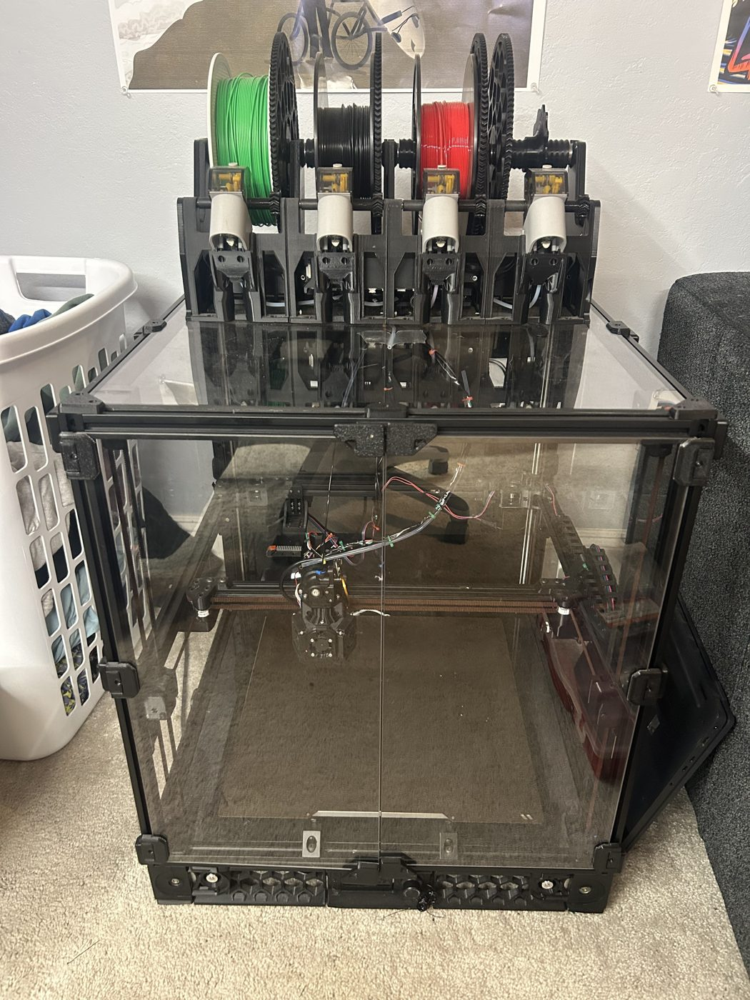
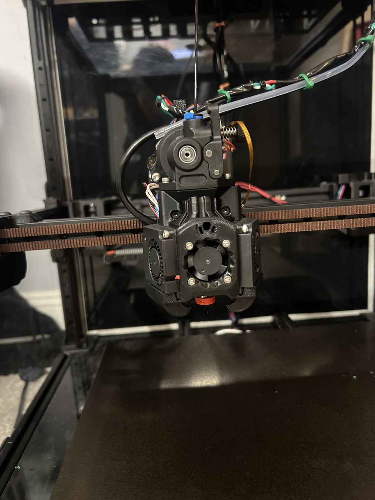

# Voron 2.4 (350 mm) Klipper Config

The Klipper configuration for the Voron 2.4 I built. It runs on an STM32H723 mainboard with an EBB toolhead board over CAN bus.

 

## Layout

| Folder | What it is |
|---|---|
| `config/` | **The live config, exactly as it is on the printer** (synced Oct 2026): BTT Eddy Duo for Z homing, quad gantry leveling and bed mesh, four-motor Z, KAMP line purge and smart park, a gantry-mounted nozzle brush with load/unload/wipe macros, and a BTT mini12864 display |
| `eddy-rebuild/` | The August 2026 upgrade package that added the Eddy, with the step-by-step commissioning runbook |
| `archive/` | Files no longer on the printer (the T-D500 thermistor table from before the Revo hotend) |

## The interesting problem

I wanted to keep the piezo for Z homing *and* add the Eddy for fast leveling and meshing. Klipper only allows one object named `probe`, and both `[probe]` and `[probe_eddy_current]` register as `probe`. Klipper refuses to start with both.

The solution was to demote the piezo to a plain `[stepper_z] endstop_pin`. It's still the same active-low trigger on the toolhead board, but now it homes Z as an endstop. The Eddy takes over the `probe` role for quad gantry leveling and bed meshing.

**Update (Aug 17, 2026):** in practice the piezo kept false-triggering in mid-air, so I removed it. The Eddy now homes Z too (`endstop_pin: probe:z_virtual_endstop`), and `PRINT_START` loads a saved bed mesh instead of scanning before every print. Comments in `config/` that still describe the piezo are left in as history.

## Credits

- The files in `config/KAMP/` (adaptive meshing, line purge, smart park and Voron purge) come from [KAMP](https://github.com/kyleisah/Klipper-Adaptive-Meshing-Purging) (GPL-3.0).
- `mainsail.cfg` and `timelapse.cfg` come from the Mainsail and moonraker-timelapse projects.
- The Eddy runbook was written with help from Claude (AI).
