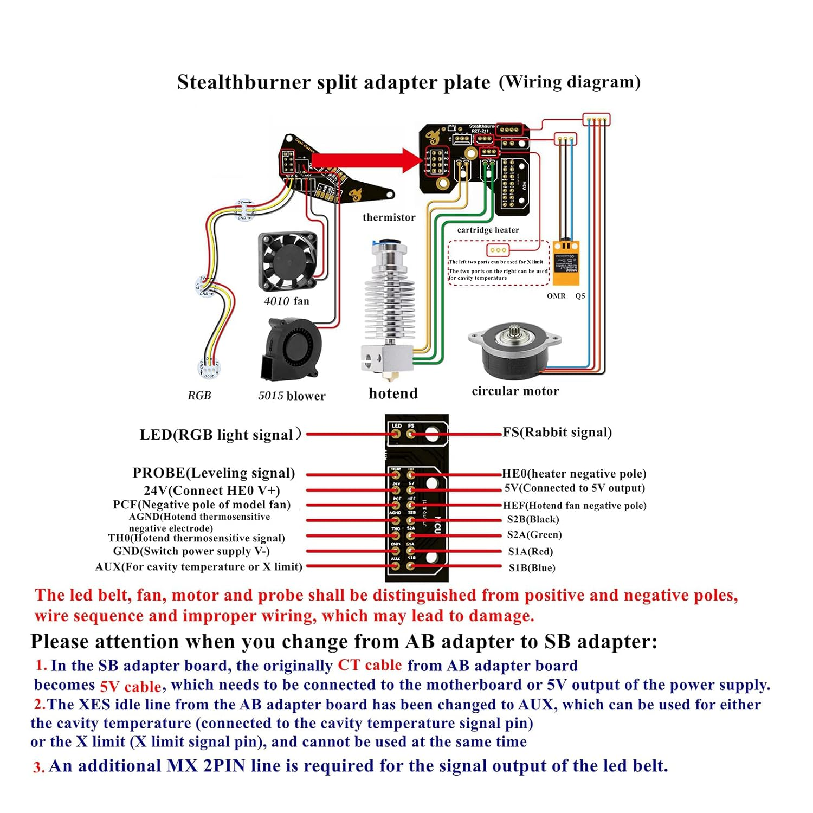

# Voron 2.4 (350 mm) Klipper Config

The Klipper configuration for the Voron 2.4 I built. It runs on an STM32H723 mainboard with an EBB toolhead board over CAN bus.

> 📸 *Add a photo of the printer here: `docs/printer.jpg`*

## Layout

| Folder | What it is |
|---|---|
| `config/` | The original setup: a piezo nozzle probe, four-motor Z with quad gantry leveling, and KAMP adaptive meshing and purging, plus a custom thermistor table for the T-D500 hotend |
| `eddy-rebuild/` | The upgrade to a **BTT Eddy Duo** eddy-current probe, with a step-by-step commissioning runbook |

## The interesting problem

I wanted to keep the piezo for Z homing *and* add the Eddy for fast leveling and meshing. Klipper only allows one object named `probe`, and both `[probe]` and `[probe_eddy_current]` register as `probe`. Klipper refuses to start with both.

The solution was to demote the piezo to a plain `[stepper_z] endstop_pin`. It's still the same active-low trigger on the toolhead board, but now it homes Z as an endstop. The Eddy takes over the `probe` role for quad gantry leveling and bed meshing.

## Credits

- Adaptive meshing, line purge, smart park and Voron purge macros come from [KAMP](https://github.com/kyleisah/Klipper-Adaptive-Meshing-Purging) (GPL-3.0).
- `mainsail.cfg` and `timelapse.cfg` come from the Mainsail and moonraker-timelapse projects.
- The Eddy runbook was written with help from Claude (AI).
